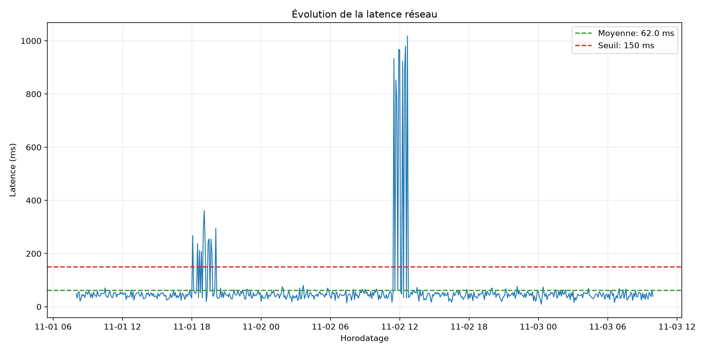
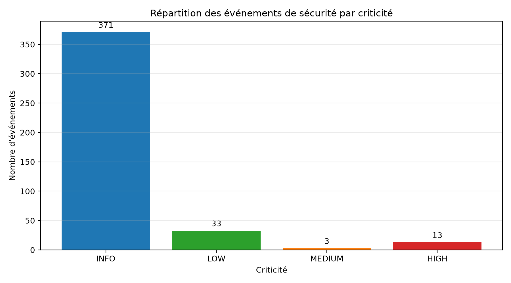
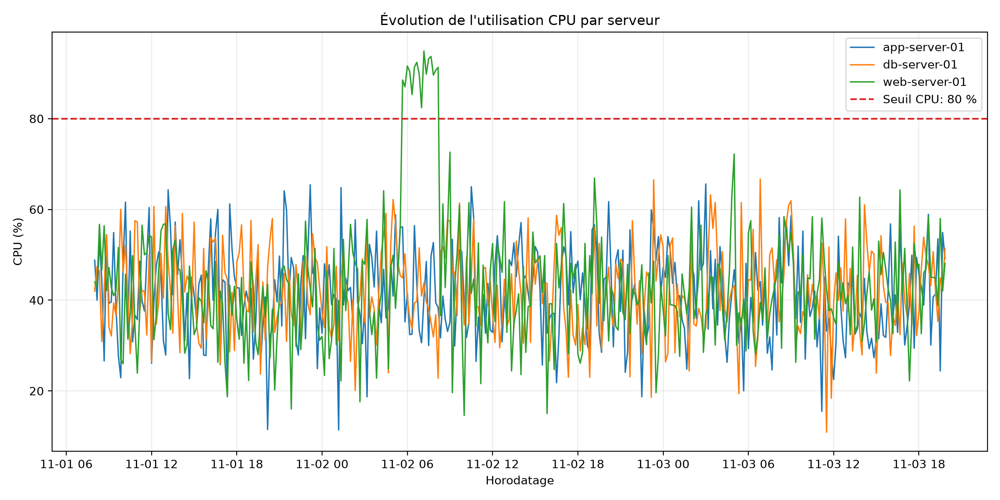
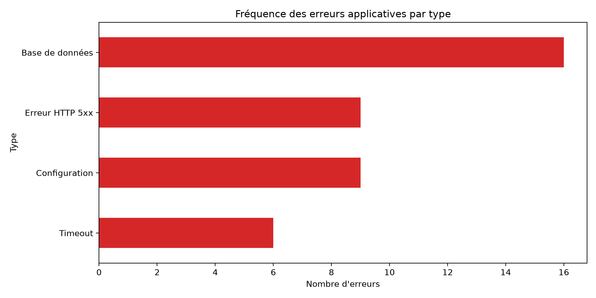

# Rapport d'analyse AIOps — Étape 1

Ce rapport couvre les six éléments de l'étape 1 : chargement et contrôle des données, analyses réseau, sécurité, système et application, puis synthèse des anomalies.

## 1. Chargement et qualité des données

| Source | Enregistrements | Valeurs manquantes | Doublons |
|---|---:|---:|---:|
| network_logs.csv | 600 | 0 | 0 |
| security_logs.csv | 420 | 0 | 0 |
| system_metrics.csv | 1080 | 0 | 0 |
| application_logs.txt | 500 | Non applicable | Contrôle ligne par ligne |

Les trois fichiers CSV ne contiennent ni valeur manquante ni doublon. Les types sont contrôlés lors de l'exécution et les horodatages sont convertis avant les analyses temporelles. Les cinq premières lignes de chaque source et la configuration JSON sont également affichées à l'exécution.

## 2. Données réseau

- Communications analysées : 600
- Latence moyenne : 62.03 ms
- Taux d'échec : 1.50 %
- Communications par statut : {'OK': 579, 'SLOW': 12, 'FAILED': 9}
- Protocoles : {'TCP': 454, 'UDP': 146}
- Ports les plus utilisés : {443: 156, 5432: 156, 53: 146, 80: 142}

Les statuts `FAILED`, le taux d'échec et les timeouts renseignent sur la disponibilité. La latence, les statuts `SLOW` et les dépassements du seuil configuré renseignent sur la performance.

## 3. Événements de sécurité

- Authentifications réussies : 116
- Authentifications échouées : 28
- Utilisateurs concernés par les échecs : {'admin': 14, 'analyst': 5, 'operator': 4, 'app_user': 4, 'support': 1}
- Événements par adresse IP source : {'172.16.0.12': 117, '192.168.1.51': 108, '10.0.0.40': 97, '192.168.1.50': 85, '203.0.113.77': 13}
- Échecs d'authentification par IP : {'203.0.113.77': 13, '10.0.0.40': 5, '192.168.1.51': 5, '172.16.0.12': 4, '192.168.1.50': 1}
- Répartition par criticité : {'INFO': 371, 'LOW': 33, 'MEDIUM': 3, 'HIGH': 13}
- Seuil de répétition configuré : 5 échecs

### Adresses IP dépassant le seuil

- 203.0.113.77: 13
- 10.0.0.40: 5
- 192.168.1.51: 5

Une succession d'échecs peut correspondre à une attaque par force brute ou à du credential stuffing. L'investigation doit vérifier la fenêtre temporelle, les comptes visés, l'origine réseau et l'existence d'une authentification réussie après les échecs.

## 4. Ressources système

### CPU moyen par serveur

- web-server-01: 43.66 %
- db-server-01: 42.15 %
- app-server-01: 41.41 %

### Mémoire moyenne par serveur

- db-server-01: 59.94 %
- app-server-01: 58.58 %
- web-server-01: 57.25 %

- Serveur avec le pic disque le plus élevé : app-server-01 (97.20 %)
- Nombre de mesures dépassant au moins un seuil : 62

### Périodes de dépassement

- 2026-11-02 05:40:00 — web-server-01: CPU
- 2026-11-02 05:50:00 — web-server-01: CPU
- 2026-11-02 06:00:00 — web-server-01: CPU
- 2026-11-02 06:10:00 — web-server-01: CPU
- 2026-11-02 06:20:00 — web-server-01: CPU
- 2026-11-02 06:30:00 — web-server-01: CPU
- 2026-11-02 06:40:00 — web-server-01: CPU
- 2026-11-02 06:50:00 — web-server-01: CPU
- 2026-11-02 07:00:00 — web-server-01: CPU
- 2026-11-02 07:10:00 — web-server-01: CPU
- 2026-11-02 07:20:00 — web-server-01: CPU
- 2026-11-02 07:30:00 — web-server-01: CPU
- 2026-11-02 07:40:00 — web-server-01: CPU
- 2026-11-02 07:50:00 — web-server-01: CPU
- 2026-11-02 08:00:00 — web-server-01: CPU
- 2026-11-02 08:10:00 — web-server-01: CPU
- 2026-11-02 22:20:00 — db-server-01: memory
- 2026-11-02 22:30:00 — db-server-01: memory
- 2026-11-02 22:40:00 — db-server-01: memory
- 2026-11-02 22:50:00 — db-server-01: memory
- 2026-11-02 23:00:00 — db-server-01: memory
- 2026-11-02 23:10:00 — db-server-01: memory
- 2026-11-02 23:20:00 — db-server-01: memory
- 2026-11-02 23:30:00 — db-server-01: memory
- 2026-11-02 23:40:00 — db-server-01: memory
- 2026-11-02 23:50:00 — db-server-01: memory
- 2026-11-03 00:00:00 — db-server-01: memory
- 2026-11-03 00:10:00 — db-server-01: memory
- 2026-11-03 00:20:00 — db-server-01: memory
- 2026-11-03 00:30:00 — db-server-01: memory
- 2026-11-03 00:40:00 — db-server-01: memory
- 2026-11-03 00:50:00 — db-server-01: memory
- 2026-11-03 15:00:00 — app-server-01: disk
- 2026-11-03 15:10:00 — app-server-01: disk
- 2026-11-03 15:20:00 — app-server-01: disk
- 2026-11-03 15:30:00 — app-server-01: disk
- 2026-11-03 15:40:00 — app-server-01: disk
- 2026-11-03 15:50:00 — app-server-01: disk
- 2026-11-03 16:00:00 — app-server-01: disk
- 2026-11-03 16:10:00 — app-server-01: disk
- 2026-11-03 16:20:00 — app-server-01: disk
- 2026-11-03 16:30:00 — app-server-01: disk
- 2026-11-03 16:40:00 — app-server-01: disk
- 2026-11-03 16:50:00 — app-server-01: disk
- 2026-11-03 17:00:00 — app-server-01: disk
- 2026-11-03 17:10:00 — app-server-01: disk
- 2026-11-03 17:20:00 — app-server-01: disk
- 2026-11-03 17:30:00 — app-server-01: disk
- 2026-11-03 17:40:00 — app-server-01: disk
- 2026-11-03 17:50:00 — app-server-01: disk
- 2026-11-03 18:00:00 — app-server-01: disk
- 2026-11-03 18:10:00 — app-server-01: disk
- 2026-11-03 18:20:00 — app-server-01: disk
- 2026-11-03 18:30:00 — app-server-01: disk
- 2026-11-03 18:40:00 — app-server-01: disk
- 2026-11-03 18:50:00 — app-server-01: disk
- 2026-11-03 19:00:00 — app-server-01: disk
- 2026-11-03 19:10:00 — app-server-01: disk
- 2026-11-03 19:20:00 — app-server-01: disk
- 2026-11-03 19:30:00 — app-server-01: disk
- 2026-11-03 19:40:00 — app-server-01: disk
- 2026-11-03 19:50:00 — app-server-01: disk

## 5. Journaux applicatifs

- Événements analysés : 500
- Lignes non reconnues : 0
- Répartition des niveaux : {'INFO': 460, 'WARNING': 0, 'ERROR': 40}
- Erreurs par type : {'Base de données': 16, 'Configuration': 9, 'Erreur HTTP 5xx': 9, 'Timeout': 6}
- Messages d'erreur les plus fréquents : {'Database connection failed': 13, 'Invalid application configuration': 9, 'HTTP 500 Internal Server Error': 9, 'Request timeout': 6, 'Connection pool exhausted': 3}

## 6. Anomalies principales

- Les échecs réseau et les latences dépassant le seuil doivent être rapprochés des services et ports concernés.
- Les IP présentant plusieurs échecs d'authentification nécessitent une investigation de sécurité.
- Les dépassements CPU, mémoire ou disque doivent être examinés sur les serveurs et périodes listés.
- Les erreurs applicatives récurrentes doivent être corrélées avec les anomalies réseau et système proches dans le temps.

## Vérification de couverture des consignes

| Exigence | État |
|---|---|
| Charger les trois CSV, le journal texte et le JSON | Réalisé |
| Afficher les cinq premières lignes | Réalisé à l'exécution |
| Contrôler volumes, types, valeurs manquantes et doublons | Réalisé |
| Calculer toutes les statistiques réseau demandées | Réalisé |
| Représenter l'évolution de la latence | Réalisé et intégré |
| Analyser authentifications, utilisateurs, IP et criticité | Réalisé |
| Analyser CPU, mémoire, disque et dépassements de seuils | Réalisé |
| Représenter l'évolution CPU | Réalisé et intégré |
| Extraire et regrouper les journaux applicatifs | Réalisé |
| Représenter la fréquence des erreurs | Réalisé et intégré |
| Présenter statistiques et anomalies dans un rapport | Réalisé |
